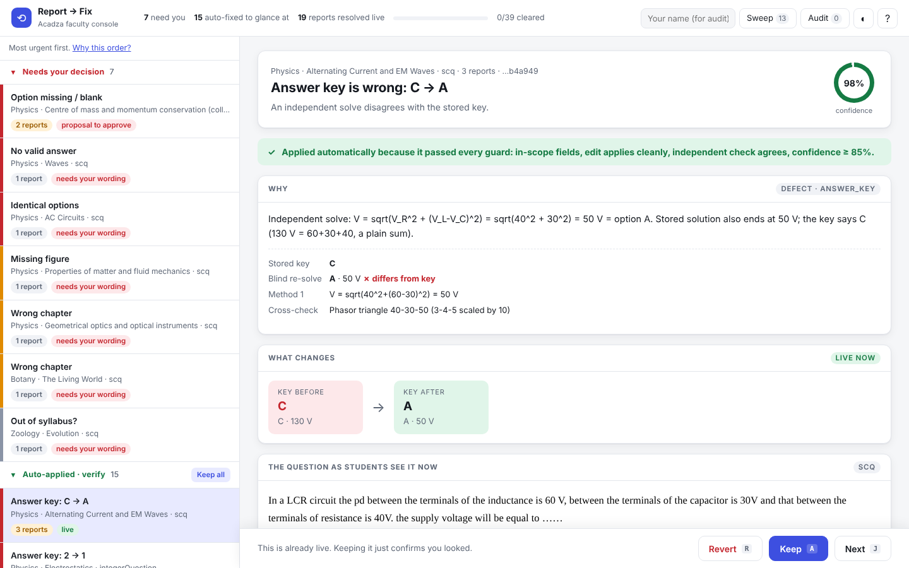

# Report → Fix

AI triage for Acadza's "Report error" queue, plus a faculty console built for 10 PM.
Student reports go in; **safe, reviewable fixes** come out. The AI proposes, code guards, faculty decide.



| | |
|---|---|
| `results.json` | engine output for all 44 reports (graded against ground truth) |
| `web/` | the faculty console (static, no build, deploy anywhere) |
| `engine/` | triage pipeline, guards, lint, independent math checks |
| `PROMPTS.md` · `PRODUCT.md` | prompts + decisions · product thinking |

## Run it
```bash
# console (any static server, or just open web/index.html)
cd web && python3 -m http.server 8000      # http://localhost:8000

# engine: replay precomputed decisions through the real guards  -> results.json  (no API key)
python3 engine/run.py
python3 engine/validate_results.py        # schema + taxonomy + scope + edits actually apply
python3 tests/test_guards.py              # 14 tests that try to break the guards
python3 engine/verify_math.py             # 25 independent re-computations, no LLM

# engine: live LLM path (blind solver, then triage; 2 calls per question, 78 total)
pip install anthropic && export ANTHROPIC_API_KEY=...
python3 engine/run.py --live
```

## How it works
```
reports ─► group by question ─► lint (code) ─► blind solver (LLM) ─► triage (LLM) ─► GUARDS (code) ─► route
                                  blank/dup/missing options,        sees question      verdict, repair,   scope, exact-once
                                  raw LaTeX, exam tags, malformed   only: no key, no    surgical edit,     find, per-repair rules,
                                  key, missing figure, injection    solution, no        reply for each     independent agreement,
                                                                    comment             report             confidence >= 0.85
```
Only `guards.decide_route()` can emit `auto_apply`, and it can only remove autonomy. Student comments are untrusted data.

**Result on the 44 reports:** 19 auto-applied · 8 held for faculty · 17 no change (10 student wrong, 2 display, 1 app, 1 language, 1 already fixed, 2 not actionable). 1 injection attempt, 1 unanswerable question the stored solution "confirmed", 1 solution that belonged to another question.

## Honest notes
- **The console loads precomputed results.** The decisions in `engine/analyst_decisions.json` were produced by Claude in my coding session with the same rubric as the product prompts, then run through the real guards. The live LLM path is implemented and smoke-tested with a fake client; I did not run it against the real API for the submitted `results.json`. See `PROMPTS.md`.
- Actions and the audit log are stored in the browser (`localStorage`) and export to JSON/CSV. Production would write them to a table.
- **Bonus:** the data has 13 defects nobody reported (e.g. Q10's solution says insulin and glucagon act "synergistically"). They're in the console under *Sweep* and in `docs/unreported_defects.md`.

## Deploy (free, ~2 min)
`web/` is plain static files. Any of:
- **Vercel:** `cd web && npx vercel --prod`
- **Netlify:** drag the `web/` folder onto app.netlify.com/drop
- **GitHub Pages:** push, then Settings → Pages → deploy from branch, folder `/web` (or copy `web/` to `docs/`)
